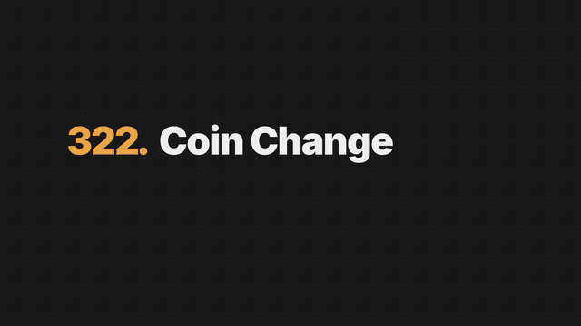
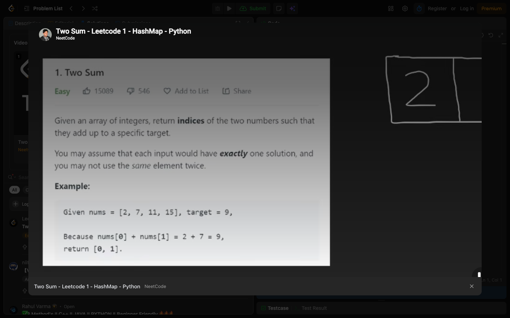
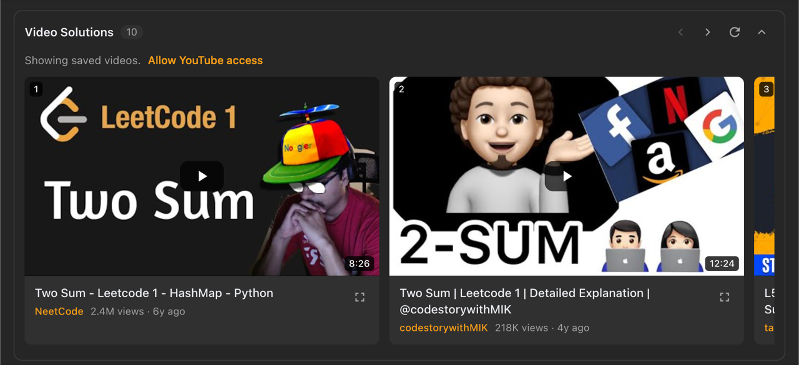
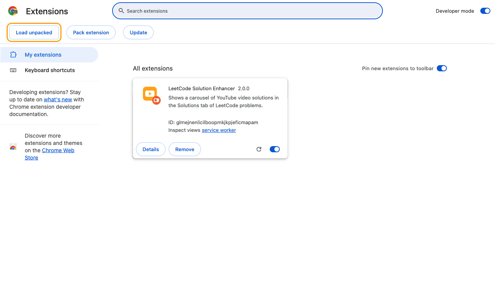

<div align="center">
  

  <h1>LeetCode Solution Enhancer</h1>

  <p>YouTube video solutions in the Solutions tab of every LeetCode problem.</p>

  <!-- Point both links at the store listings once they are published. -->
  <p>
    <a href="https://chromewebstore.google.com/"></a>
    &nbsp;
    <a href="https://addons.mozilla.org/firefox/"></a>
  </p>

<a href="docs/demo.mp4"></a>
</div>

## Features

- **Well-known channels first.** Videos from a curated set of popular LeetCode channels come first, followed by the best matches from the rest of YouTube.
- **Watch without leaving LeetCode.** Play a video inside the carousel, or open it in a larger player.
- **Matched to the exact problem.** Videos about a sequel or a different problem number are filtered out.
- **Desktop and mobile.** The carousel appears on LeetCode's desktop layout and on the page it serves to phones, in light and dark themes.
- **Works without live search.** A list of videos ships with the extension, so the carousel still fills when YouTube search is unavailable.

## Screenshots

<table>
  <tr>
    <td width="66%"></td>
    <td width="34%"></td>
  </tr>
  <tr>
    <td align="center">Larger player</td>
    <td align="center">Mobile layout</td>
  </tr>
</table>

## Usage

Open the **Solutions** tab of any problem. The videos appear above the list of community solutions.

- Click a thumbnail to play the video in the carousel.
- The expand button on each card opens the video in a larger player, which <kbd>Esc</kbd> or a click outside dismisses.
- Click a video's title, or the YouTube logo inside the player, to open it on YouTube.
- Use the arrow buttons, or the arrow keys once the carousel has focus, to scroll through the videos.
- The refresh button searches YouTube again, and the chevron collapses the carousel.

If the carousel shows **Allow YouTube access**, click it and accept the browser prompt to enable live search. Until then it shows the videos bundled with the extension.



## Privacy

The extension collects no data and has no analytics. It stores cached search results and whether the carousel is collapsed in your browser's local extension storage. Its only network requests go to YouTube: search pages to find videos, plus thumbnails and the embedded player.

## Install from source

<details>
<summary>Build and load the extension yourself</summary>

<br>

```sh
bun install
bun run build:chrome
bun run build:firefox
```

**Chrome:** open `chrome://extensions`, turn on **Developer mode**, click **Load unpacked** and select the `.output/chrome-mv3` folder.



**Firefox:** open `about:debugging#/runtime/this-firefox`, click **Load Temporary Add-on…** and select `.output/firefox-mv3/manifest.json`. Firefox removes add-ons loaded this way when it closes.

</details>

## Contributing

Development, testing and release notes are in [docs/DOCS.md](docs/DOCS.md).

## License

[GNU General Public License v3.0](LICENSE). You may use, change and share this extension. Anything you distribute that is based on it must be released under the same license, with its source code.
